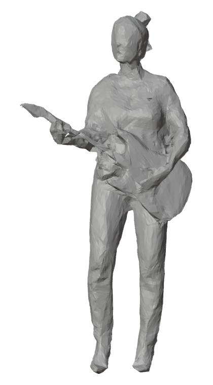

# Watertight Volumetric Mesh Capture (TSDF → V-DMC / Alembic)

### ▶ Project page: **https://abdulrehman786302.github.io/realtime-tsdf-mesh-capture-/**

A 10-camera RGB-D rig fused into a sparse TSDF, meshed by marching cubes, cleaned to an almost watertight textured
mesh, and exported as V-DMC bitstreams and Alembic.

**Pipeline:** brick TSDF → marching cubes → sliver-safe repair, inner-shell guard, smoothing and ear-clipped hole caps
→ decimation and texture bake → V-DMC from a ~2,500-face base mesh, plus Alembic export.

## Key numbers

| | |
|---|---|
| **58–69 KB** | per frame, V-DMC (mesh + texture), subdivision 3, decimation target 0.01 |
| **0.3 mm** | median geometry error of the decoded mesh (p99 3.7–4.3 mm) |
| **~33 s** | export per frame (mesh 3 s, decimate 10 s, UV 4 s, bake 10 s, write 6 s) |

## This repository

The project page only: a static `index.html` (no build step) and its media in `assets/`, served by GitHub Pages from
`main` / root. The capture pipeline itself is not public.
